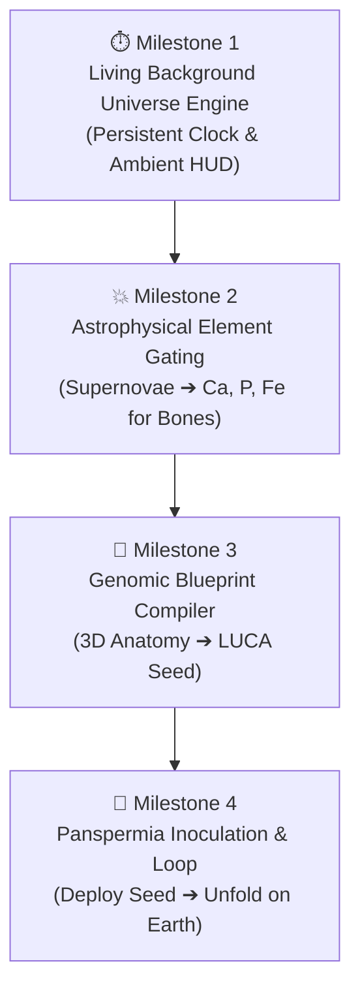

# Master Development Plan: The Cosmic Demiurge Architecture

> **Execution Date:** Ready for tomorrow's development sprint.  
> **Core Objective:** Connect the **Living Background Universe**, the **Astrophysical Element Bridge**, and the **3D Macro-Blueprint Genomic Compiler**.

---

## 🎯 Sprint Overview

---

## 📋 Actionable Milestones & Tasks

### ⏱️ Milestone 1: Living Background Universe Simulation Clock
* **Goal:** Keep the cosmic simulation ticking in the background regardless of active view.
* **Tasks:**
  - [ ] **Background Simulation Web Worker (`src/universe-simulation/workers/CosmicClockWorker.ts`):**
    - Runs a lightweight cosmic epoch timer (13.8 Ga scaled progression).
    - Dispatches epoch transitions (`BIG_BANG` $\to$ `PLASMA` $\to$ `STELLAR_DAWN` $\to$ `GALAXY` $\to$ `SOLAR_SYSTEM` $\to$ `EARTH`).
  - [ ] **Ambient Cosmic Skybox / Mini-PiP HUD:**
    - Mount a subtle, non-intrusive cosmic epoch indicator badge in the top navigation bar.
    - Shows current cosmic time (e.g. `100 My - Stellar Dawn`) with 1-click teleport to full 3D Universe.

---

### 💥 Milestone 2: Astrophysical Element Gating & Resource Bridge
* **Goal:** Scientifically gate creation in Particle, Chemistry, and Anatomy labs by cosmic nucleosynthesis.
* **Tasks:**
  - [ ] **Epoch Resource Matrix (`src/constants/cosmicEpochGating.js`):**
    - `BIG_BANG` / `PLASMA`: Unlocks Hydrogen ($H$), Helium ($He$), Lithium ($Li$).
    - `STELLAR_DAWN`: Unlocks core fusion products: Carbon ($C$), Nitrogen ($N$), Oxygen ($O$).
    - `SOLAR_SYSTEM` (Supernovae & Kilonovae): Unlocks heavy elements:
      - **Calcium ($Ca$) & Phosphorus ($P$):** Required for the hydroxyapatite bone mineral matrix!
      - **Iron ($Fe$):** Required for hemoglobin vascular circulation!
  - [ ] **Inventory & Bone Snapping Gate:**
    - In `AnatomyWorkbench.jsx`: Display required bone mineral resources ($Ca + P$).
    - If supernova epoch has not ignited, show helpful cosmic tip: *"Awaiting Stellar Supernova Nucleosynthesis for Calcium & Phosphorus."*

---

### 🧬 Milestone 3: 3D Macro-Blueprint to Genomic Compiler
* **Goal:** Compile the player's 3D human anatomy design into an encoded cellular seed.
* **Tasks:**
  - [ ] **Blueprint Compiler Engine (`src/anatomy-lab/utils/blueprintCompiler.js`):**
    - Reads `assembledBones.length`, active muscular tone, and neural volume from `useAnatomyStore`.
    - Translates 206 bones $\to$ Calcium/Collagen demand and osteogenesis gene regulatory network.
    - Translates neural connectome $\to$ Encephalization potential (EQ 7.6) and synaptic codon sequence.
    - Generates a **Certified Panspermia Seed (LUCA)** stored in `useInventory`.
  - [ ] **Compilation UI Modal (`src/anatomy-lab/components/GenomicCompileModal.jsx`):**
    - Inspiring sci-fi visualization: 3D skeleton compresses and condenses into a glowing double-helix DNA strand inside a lipid membrane!
    - Action: `[PACKAGE INTO PRIMORDIAL SEED (LUCA)]`.

---

### 🌱 Milestone 4: Panspermia Inoculation & The Complete Cycle
* **Goal:** Deploy the compiled seed to Earth and watch evolution unfold your design.
* **Tasks:**
  - [ ] **Panspermia Inoculation Animation in `PlanetaryView.jsx`:**
    - When dropping the certified seed into the ocean, trigger a hydrothermal vent cinematic sequence.
    - Seed's starting stats (Metabolism, Robustness, EQ Potential) determine evolutionary speed along the cladogram.
  - [ ] **End-to-End Regression & Verification:**
    - Verify all 36 test suites and 169+ tests continue to pass 100% green.
    - Ensure clean Vite production build in <7s.

---

## 🛠️ Tech Stack & Guardrails
* **No Breaking Changes:** Zero disruption to existing Particle, Chemistry, or Biology labs.
* **Zero Cognitive Friction:** Clean, OLED-dark aesthetic (`#06080e`), atomic micro-actions, instant tactile feedback.
* **Performance:** Persistent worker throttled to <1% CPU overhead; 60 FPS WebGL guarantee.
