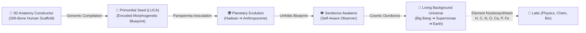

# 🌌 Origin Lab — The Cosmic Architect & 206-Bone Demiurge Sandbox

**Origin Lab** is an interactive, multi-scale scientific simulation game. You act as the **Cosmic Architect (Demiurge)**: engineering human macro-anatomy in 3D, compiling it into a synthetic genetic seed, and deploying it into primordial Earth while a **living universe evolves in the background**.

---

## 🧭 The 6 Core Pillars



---

### 🌌 1. [Living Background Universe](file:///home/tsylop/protocol/origin-lab/src/universe-simulation/UniverseSimulationView.jsx)
* **Real-Time Cosmic Evolution:** Runs continuously in the background across 6 GLSL epochs:
  1. **Big Bang Singularity:** Inflation & 4D quantum noise.
  2. **Quark-Gluon Plasma:** Relativistic particle thermodynamics.
  3. **Stellar Dawn:** Jeans collapse synthesizing Carbon, Nitrogen, and Oxygen.
  4. **Galaxy Accretion:** Spiral density waves with multi-threaded N-body computation.
  5. **Solar System & Supernovae:** Stellar nucleosynthesis generating **Calcium & Phosphorus** (required for bone mineral matrix) and **Iron** (for blood).
  6. **Habitable Earth:** Magma ocean cooling, volatile outgassing, and ocean condensation.
* **Ambient Backdrop & PiP:** View the cosmic clock from anywhere in the game.

### ⚛️ 2. [Particle Lab](file:///home/tsylop/protocol/origin-lab/src/particle-lab/ParticleLab.jsx) (Subatomic Physics)
* HTML5 Canvas engine with Coulomb forces, strong nuclear binding, and radioactive decay cascades.
* Fuse Quarks $\to$ Nucleons $\to$ Complete Periodic Table (118 elements).
* Assemble foundational organic molecules: Nucleotides, Amino Acids, and DNA/RNA backbones.

### ⚗️ 3. [Chemistry Lab](file:///home/tsylop/protocol/origin-lab/src/chemistry-lab/ChemistryApp.jsx) (Thermodynamics & Kinetics)
* Tick-based Arrhenius chemical kinetics with $\Delta H$, $\Delta G$, and dynamic pH titrations.
* Modular glassware: Autoclaves, Condensers, Distillation Columns, and Bunsen burners.
* Synthesize prebiotic compounds: Strecker glycine, Formose sugars, and lipid micelles.

### 🧫 4. [Biology Lab & 3D Protein Folding](file:///home/tsylop/protocol/origin-lab/src/biology-lab/BiologyApp.jsx)
* **64-Codon Genetic Studio:** $5' \to 3'$ DNA transcription $\to$ mRNA translation $\to$ amino acids.
* **Real-Time 3D Protein Folding:** Parametric Catmull-Rom ribbons, $\alpha$-helices, $\beta$-sheets, and covalent disulfide ($S-S$) bridges with live $\Delta G$ thermodynamic telemetry.
* **Agent-Based Bioreactor:** 32-bit spatial hashing simulation with Darwinian natural selection.

### 🦴 5. [206-Bone Anatomy Lab](file:///home/tsylop/protocol/origin-lab/src/anatomy-lab/AnatomyLab.jsx) (The Macro-Architect)
* **Full Granular Human Assembly:** Pick up and snap all **206 individual human bones** (80 Axial, 126 Appendicular) with Latin nomenclature and landmark coordinates.
* **4 Anatomical Layers:**
  1. *Articular Cartilage & Ligaments:* Intervertebral discs, menisci, costal cartilage.
  2. *Myofascial Musculature:* Real-time strain heatmaps (tight/spastic vs. atrophied).
  3. *Pulsatile Vascular Loop:* 4-chamber heart with systolic arterial pulse waves.
  4. *Neural Connectome:* Brain hemispheres, spinal cord, and synaptic action potentials.
* **Closed-Chain Biomechanics:** Posture sliders physically deform the skeletal rig in real time.

### 🌍 6. [Planetary Evolution & The Cosmic Ouroboros](file:///home/tsylop/protocol/origin-lab/src/components/PlanetaryView.jsx)
* Deploy your engineered **Panspermia Seed** into Earth's primordial oceans.
* Guide evolution through mass extinctions, volcanic calderas, and asteroid strikes.
* When the 206-bone observer awakens with 42 Hz Gamma brainwaves, the loop completes: transcend back into the Singularity with ascended cosmic mastery!

---

## 🛠️ Tech Stack & Performance

* **Core:** React 18 + Vite (Production build in <7s, code-split under 440 kB).
* **3D & Shaders:** Three.js + WebGL custom GLSL shaders (60 FPS guaranteed).
* **State Management:** Zustand with Universal Ledger (`useInventory`) connecting all labs.
* **Automated Tests:** Vitest (36 test suites, 169 unit & integration tests, 100% green).

---

## 🚀 Quick Start

```bash
# 1. Install dependencies
npm install

# 2. Start development server
npm run dev

# 3. Run automated test suite
npm test -- --run

# 4. Build production bundle
npm run build
```
