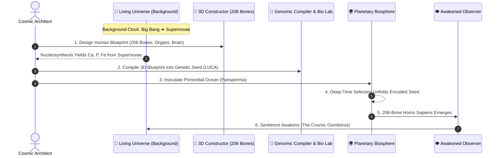

# The Bigger Picture: The Cosmic Architect & The Living Universe

> **Core Philosophy:** You are not just a spectator waiting 4 billion years for evolution.  
> You are the **Cosmic Demiurge** — you design the ultimate human blueprint in 3D, encode it into a cellular seed, and inoculate primordial Earth while a **living universe evolves in the background**.

---

## 🔁 The Grand Loop Architecture

---

## 🌟 The 5 Pillars of the New Paradigm

### 1. 🦴 The 3D Macro-Blueprint (Target Organism)
* Instead of starting with blind single cells, you have the vision of the end goal: **The Human Being**.
* In the **3D Anatomy Lab**, you assemble all **206 individual bones** (80 Axial, 126 Appendicular), calibrate closed-chain biomechanics, and layer on articular cartilage, musculature, beating heart, and neural connectome.
* This establishes the **Structural & Morphogenetic Target**.

---

### 2. 🌌 The Living Background Universe
* **Always-On Simulation:** The Universe does not pause when you enter labs. It runs continuously in the background via a dedicated simulation clock.
* **Astrophysical Resource Unlocks:**
  * **Big Bang & Primordial Era:** Yields only Hydrogen ($H$) and Helium ($He$).
  * **Stellar Dawn (Main Sequence Fusion):** Core fusion cooks Carbon ($C$), Nitrogen ($N$), and Oxygen ($O$) — needed for amino acids and DNA.
  * **Supernovae & Neutron Star Mergers:** Violent stellar deaths forge **Calcium ($Ca$)** and **Phosphorus ($P$)** — the exact hydroxyapatite minerals required to build bones, plus **Iron ($Fe$)** for hemoglobin blood.
* **Multitasking:** Craft particles or snap bones while watching the stars ignite through an ambient skybox.

---

### 3. 🧬 The Genomic Compiler & The Seed
* **Top-Down Translation:** Your 3D anatomical design is mathematically compiled:
  * Bone mass $\to$ Calcium phosphate ($Ca_3(PO_4)_2$) requirements & osteoblast gene regulatory networks.
  * Muscle & connective tissue $\to$ Collagen & actin/myosin protein folding sequences.
  * Neural complexity $\to$ Encephalization genes (e.g., *NOTCH2NL*, *ARHGAP11B*).
* **The Packaging:** The compiled genetic code is packaged into a viable **Primordial Seed (LUCA)** inside the Biology Lab.

---

### 4. 🌍 Panspermia Inoculation & Planetary Deep Time
* Return to the planetary view of cooling Earth and drop the **Seed** into the hydrothermal oceans.
* **Environmental Stewardship:** You no longer micromanage individual cells. You steer the global planet:
  * Regulate greenhouse gases ($CO_2$, $CH_4$) and ocean pH.
  * Guide life through Snowball glaciations, supervolcano calderas, and asteroid impacts.
* **The Teleological Payoff:** The seed's encoded blueprint guides natural selection upward toward the 206-bone hominid body you engineered!

---

### 5. ♾️ The Cosmic Ouroboros (Awakening & Singularity Loop)
* When the 206th bone articulates and the cerebral cortex ignites, **Consciousness Awakens**:
  * Heart beats at 72 BPM; Gamma brainwaves hum at 42.5 Hz.
  * The observer looks up through telescopes and discovers the very physics that birthed it.
* **Transcendence:** The cycle completes. The awakened player can ignite the **Cosmic Ouroboros**, restarting the Singularity with **Ascended Architect Status**!
